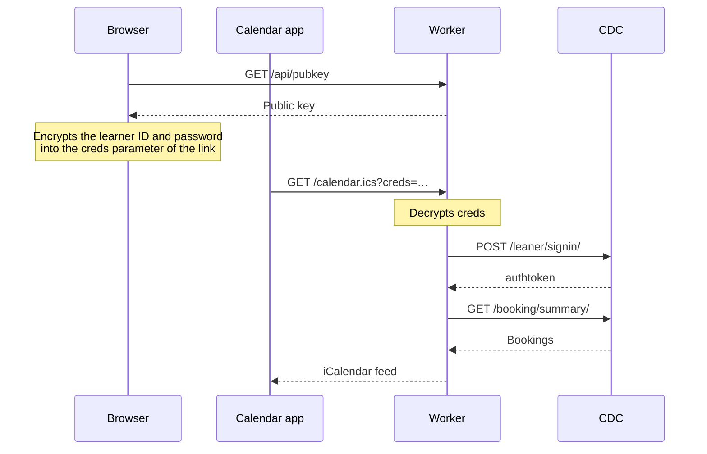

# mycdc

See your ComfortDelGro Driving Centre (CDC) bookings in the calendar you
already use: iPhone, iPad, Mac, Google Calendar or Outlook. Subscribe once, and
new bookings show up on their own.

It's running at <https://mycdc.app>, and this repository is all of its code.
You're welcome to read it, run your own copy, or help improve it.

> **Unofficial.** This isn't built by, endorsed by, or connected to
> ComfortDelGro Driving Centre. Please only use it with your own account.

## How it works



There's no database. Your browser encrypts your learner ID and password, and
the result travels inside the subscription link. Each time your calendar app
refreshes, a Cloudflare Worker decrypts it, signs in to CDC, and turns your
bookings into an iCalendar feed.

## Running your own copy

You'll need a Cloudflare account and Node.js.

1. Fork this repository.
2. Run `npm install && npm run keygen`, and keep the private JWK it prints.
   You'll need it in step 4.
3. In the Cloudflare dashboard, go to **Workers & Pages → Create → Workers →
   Import a repository** and pick your fork. The defaults are fine, because
   Wrangler reads `wrangler.jsonc`.
4. After the first deploy, open **Settings → Variables and Secrets**, add a
   **Secret** named `CDC_PRIVATE_KEY_JWK` holding the private JWK, and deploy
   again.
5. Swap in your own values from
   [Values to change in your own copy](#values-to-change-in-your-own-copy).

From then on, every push to the default branch deploys. If you see "This site
isn't set up yet", the secret from step 4 is still missing.

## Running it locally

```sh
npm install
npm run keygen   # copy the .dev.vars line it prints into .dev.vars
npm run dev
```

`npm run typecheck` runs TypeScript over the Worker.

One thing to know: the Cache API does nothing under `wrangler dev`, so every
local request goes all the way to CDC.

## Endpoints

| Route | What you get |
| --- | --- |
| `GET /calendar.ics?creds=…` | The iCalendar feed. Add `&alarm=<minutes>` to set the reminder: it defaults to `60`, and `0` turns it off |
| `GET /api/preview?creds=…` | The booking count and the first five bookings as JSON. The page uses it to test a new link |
| `GET /api/pubkey` | The public key the page encrypts to |

Everything else is served from `public/`.

## How credentials are protected

The page encrypts the learner ID and password in the browser with ECIES over
P-256 (ECDH, HKDF-SHA256, AES-256-GCM), and the result becomes the `creds`
parameter. If you'd like the byte layout, it's in
[DESIGN.md](DESIGN.md#credential-blob).

Here's who can do what with a link:

| Who | Can | Can't |
| --- | --- | --- |
| Anyone who has the link | Read the bookings, by requesting the link | Read the password, or sign in to CDC |
| The Worker | Read the password while it handles a request | Read it at any other time, because it stores neither the link nor the password |

Two things follow from that:

- **To switch a link off, change the CDC password.** Every link made with the
  old password stops working.
- **Replacing `CDC_PRIVATE_KEY_JWK` breaks every link** already added to a
  calendar, so keep that key safe.

## Caching

The Worker keeps two copies of each learner's bookings, so that a calendar app
that refreshes often doesn't send a request to CDC every time:

| Copy | Kept for | Served when |
| --- | --- | --- |
| Fresh | 15 minutes | Always |
| Stale | 48 hours | CDC can't be reached, so an outage there doesn't empty a subscribed calendar |

Both are stored under a SHA-256 of the credentials, never the credentials
themselves. If CDC rejects the credentials, the Worker always says so and never
answers from a cache.

Worker logs don't record query strings either: `redact_query_string` in
`wrangler.jsonc` removes them, because that's where the `creds` parameter is.

## What's in each event

| Property | Holds |
| --- | --- |
| Summary | CDC's code for the booking, such as `2BL2`, exactly as CDC writes it |
| Time | Singapore time, with `TZID=Asia/Singapore` |
| Location | The branch address, or `Zoom` for an online booking |
| Description | For a practical booking: the reporting counter, vehicle number, instructor, ticket number and map link. For an online one: the Zoom link, meeting ID and passcode |

## The CDC API

The Worker makes two calls to
`https://mapp.cdc.com.sg/learner_management/api/v1`:

| Call | Sends | Gets back |
| --- | --- | --- |
| `POST /leaner/signin/` | The fields below, form-encoded | `authtoken` |
| `GET /booking/summary/` | `Authorization: Token <authtoken>` | The learner's bookings in `data` |

A successful reply carries `code` 201 in its JSON body.

Sign-in sends these fields:

| Field | Holds |
| --- | --- |
| `CustomerID`, `password` | The learner's credentials |
| `device_os` | `ANDROID` |
| `device_type` | The request's `User-Agent`, which `src/device.ts` picks per learner ID from a list of Android handsets |
| `player_id` | 16 hexadecimal characters that `src/device.ts` derives from the learner ID |
| `device_uid` | Empty, because CDC sends the learner's push notifications to the token in this field |

The API has two habits worth knowing about, and the Worker handles both:

| CDC sometimes answers | So the Worker |
| --- | --- |
| `code` 206 to valid credentials, or to an account that has bookings | Asks up to three times before it reports the error |
| An empty booking list with `code` 201 to an account that has bookings | Asks a second time before it returns an empty calendar |

## Values to change in your own copy

| Value | Where | Replace it with |
| --- | --- | --- |
| `https://mycdc.app` | `public/index.html`, `public/robots.txt`, `public/sitemap.xml`, `scripts/og.mjs` | Your origin |
| `https://github.com/cheziyi/mycdc` | `public/index.html` | Your fork, so the page links to the code your copy runs |
| `G-3MJPXZTQFV` and the cookie name `_ga_3MJPXZTQFV` | `public/index.html` | Your Google tag ID. Or remove the tag, along with the FAQ answer that names its hosts and cookies |

After changing the origin, run `npm run og`. It redraws `public/og.png` and the
PNG icons, which are committed.

## Contributing

Issues and pull requests are very welcome. [AGENTS.md](AGENTS.md) describes how
the code and the docs are written, and [DESIGN.md](DESIGN.md) explains the
decisions behind the less obvious parts.

## Licence

[MIT](LICENSE). Copyright © 2026 the contributors.

The fonts in `public/fonts/` (Figtree, Newsreader and IBM Plex Mono) are under
the SIL Open Font License, and you'll find each licence beside its font.
